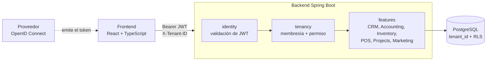

<h1 align="center">Plataforma ERP + CRM Multitenant</h1>

<p align="center">
  ERP contable y CRM modular y multitenant construido con <strong>Spring Boot</strong> y <strong>React</strong>.<br/>
  Una base de datos PostgreSQL compartida, aislamiento estricto entre tenants con Row-Level Security
  y una arquitectura hexagonal organizada por features.
</p>

<p align="center">
  
  
  
  
  
  <br/>
  
  
  
  
  
  
</p>

---

## Descripción general

Este repositorio contiene la **base del MVP** de una plataforma ERP + CRM multitenant: la base técnica multitenant y modular, la estructura de cada módulo de negocio, un frontend inicial y los servicios locales de desarrollo. La funcionalidad completa del ERP y del CRM se incorpora por etapas.

## Módulos

| Módulo | Descripción |
|---|---|
| **Tenancy** | Tenants, membresías y validación de permisos; entrega el contexto de tenant autorizado a cada feature |
| **Identity** | Validación de JWT e identificación del actor (OAuth 2.0 Resource Server) |
| **CRM** | Gestión de clientes |
| **Accounting** | Diarios de ventas y asientos contables |
| **Inventory** | Stock y movimientos de inventario |
| **POS** | Transacciones de punto de venta |
| **Projects** | Proyectos y tareas con prioridad y estado |
| **Marketing** | Campañas, plantillas de correo, gestión de consentimiento y envío por SMTP |

## Arquitectura

- **Organización por features**: cada módulo de negocio vive en su propio paquete dentro de `com.erp.features`.
- **Arquitectura hexagonal dentro de cada feature**: `domain`, `application` (casos de uso y puertos), `infrastructure` (persistencia JPA) y `presentation` (controladores REST).
- **Multitenancy con base de datos compartida**: cada fila de negocio tiene una columna `tenant_id` obligatoria.



### Estructura de una feature

```
features/<modulo>/
├── api/              # Contrato público usado por otras features
├── application/      # Casos de uso (servicios) y puertos
├── domain/           # Entidades y reglas de negocio
├── infrastructure/   # Entidades JPA, repositorios y adaptadores
└── presentation/     # Controladores REST y manejo de errores
```

## Seguridad y multitenancy

**Autenticación**
- El backend es un **OAuth 2.0 Resource Server**: valida tokens emitidos por un proveedor externo OpenID Connect y nunca almacena contraseñas.
- Cada petición protegida envía `Authorization: Bearer <token>`. Se verifican la firma y los claims `iss`, `aud`, `exp`, `nbf` y `sub`; el actor se identifica únicamente por `sub` (UUID).
- El emisor y la audiencia se configuran por entorno con `AUTH_ISSUER_URI` y `AUTH_AUDIENCE`.

**Aislamiento entre tenants**
- El cliente selecciona el tenant con el encabezado `X-Tenant-ID`. Es solo un selector, nunca una prueba de autorización.
- El módulo `tenancy` verifica que exista una **membresía activa** y el **permiso requerido** antes de acceder a cualquier dato de negocio. Los permisos son códigos explícitos por membresía; no existen roles globales.
- El contexto del tenant se establece como configuración de PostgreSQL **local a la transacción**, por lo que nunca se filtra entre conexiones del pool.
- Las políticas de **Row-Level Security** limitan lecturas y escrituras al tenant actual y **fallan cerradas** cuando no hay contexto de tenant.
- El rol de base de datos en ejecución no es superusuario, no tiene `BYPASSRLS` y no es dueño de las tablas; las migraciones usan credenciales separadas.

| Respuesta | Cuándo |
|---|---|
| `401 Unauthorized` | Token ausente o inválido |
| `403 Forbidden` | Tenant ausente o mal formado, membresía revocada o permiso insuficiente |

## Stack tecnológico

| Capa | Tecnología |
|---|---|
| Backend | Java 21, Spring Boot 3.5, Spring Web, Spring Data JPA, Spring Security (OAuth2 Resource Server), Spring Mail |
| Base de datos | PostgreSQL 16, migraciones con Flyway, Row-Level Security |
| Documentación de API | springdoc-openapi (Swagger UI) |
| Frontend | React 19, TypeScript, Vite 8 |
| Pruebas backend | JUnit 5, Spring Security Test, Testcontainers, JaCoCo |
| Pruebas frontend | Vitest, Testing Library, oxlint |
| Calidad | SonarQube, pruebas de rendimiento con k6 |
| DevOps | Docker Compose, GitHub Actions, Commitlint |

## Estructura del repositorio

```
app-distribuidas/
├── backend/                 # Aplicación Spring Boot (com.erp)
│   └── src/
│       ├── main/java/com/erp/features/   # tenancy, identity, crm, accounting, inventory, pos, projects, marketing
│       ├── main/resources/db/migration/  # Migraciones Flyway por módulo
│       └── test/                         # Pruebas unitarias, de integración y de aislamiento RLS
├── frontend/                # React + TypeScript + Vite
│   └── src/
│       ├── app/             # Layouts, providers y router
│       ├── components/      # UI reutilizable (Button, Card, Table, Drawer, Pagination, ...)
│       └── features/        # Pantallas por feature (identity, crm, accounting, inventory)
├── docker/                  # compose.yml (PostgreSQL), compose.sonarqube.yml, .env.example
├── docs/                    # Documentación de arquitectura, multitenancy, autenticación, pruebas y calidad
└── .github/
    ├── workflows/           # CI: quality gate, commitlint, auto-develop, deploy-develop
    └── projects/            # Definición de tareas y herramienta de sincronización con GitHub Projects
```

## Puesta en marcha

### Requisitos previos

- Java 21
- Maven
- Node.js 20 o superior
- Docker y Docker Compose

### 1. Levantar la base de datos

```bash
cd docker
cp .env.example .env          # definir ERP_POSTGRES_DB, ERP_POSTGRES_USER y ERP_POSTGRES_PASSWORD
docker compose up -d
```

PostgreSQL solo queda expuesto en `127.0.0.1:5432`.

### 2. Ejecutar el backend

```bash
cd backend
mvn spring-boot:run -Dspring-boot.run.profiles=dev
```

Flyway aplica las migraciones automáticamente al arrancar. Configura `AUTH_ISSUER_URI` y `AUTH_AUDIENCE` según tu proveedor de identidad.

### 3. Ejecutar el frontend

```bash
cd frontend
npm install
npm run dev
```

### Opcional: SonarQube

```bash
cd docker
docker compose -f compose.sonarqube.yml up -d
```

## Pruebas

```bash
# Backend: pruebas unitarias, de integración y de aislamiento RLS (requiere Docker para Testcontainers)
cd backend
mvn verify

# Frontend
cd frontend
npm test
npm run test:coverage
npm run lint
```

## Documentación

| Tema | Archivo |
|---|---|
| Arquitectura | [`docs/arquitectura.md`](docs/arquitectura.md) |
| Multitenancy | [`docs/multitenancy.md`](docs/multitenancy.md) |
| Operación de tenancy | [`docs/tenancy-operacion.md`](docs/tenancy-operacion.md) |
| Autenticación | [`docs/autenticacion.md`](docs/autenticacion.md) |
| Contabilidad | [`docs/accounting.md`](docs/accounting.md) |
| ORM code-first | [`docs/orm-code-first.md`](docs/orm-code-first.md) |
| Prueba de APIs | [`docs/prueba-apis.md`](docs/prueba-apis.md) |
| Estrategia de pruebas | [`docs/testing.md`](docs/testing.md) |
| Calidad de código | [`docs/quality.md`](docs/quality.md) |
| Requerimientos del CRM | [`docs/crm/requerimientos.md`](docs/crm/requerimientos.md) |

## Equipo

| Integrante | GitHub | Responsabilidad |
|---|---|---|
| Jefferson | [@jeffersonmejia](https://github.com/jeffersonmejia) | Backend y DevOps; define la arquitectura y el alcance técnico |
| Esteban | [@EMLarco](https://github.com/EMLarco) | Backend |
| Sahid | [@Sahid-B](https://github.com/Sahid-B) | Backend |
| Bruce | [@BruceRodri](https://github.com/BruceRodri) | Backend |
| Dayanara | [@Dayanarablb](https://github.com/Dayanarablb) | Frontend |
| Jennifer | [@Jntorres2001](https://github.com/Jntorres2001) | Testing (unitario, integración, rendimiento con k6) y calidad con SonarQube |

<p align="center">
  <a href="https://github.com/jeffersonmejia/app-distribuidas/graphs/contributors">
    
  </a>
</p>